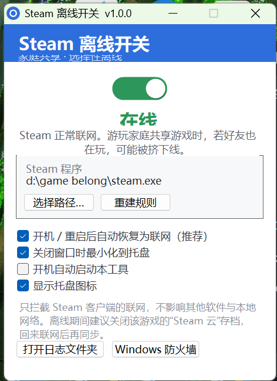

# Steam Offline Switch

[中文](README.md) · [How it works](docs/HOW-IT-WORKS.md) · [Troubleshooting](docs/TROUBLESHOOTING.md)

A tiny Windows utility that puts **the Steam client into "offline" with one click**, so you can **play the same Steam Family Sharing game at the same time as the friend who owns it** — **without unplugging your network**. Everything else on your PC keeps working online.



> Independent community tool, not affiliated with Valve / Steam. It only touches Windows Firewall: no injection, no game-file edits, no drivers. Windows 10/11 + .NET Framework 4.x (built into Windows).

---

## The problem it solves

If you're in a Steam Family (Family Sharing) group, you've hit this:

> **While your friend is playing a shared game, you can't play it** — Steam allows only one person to play a given shared title online at a time.

Whichever account is *online* and launches the game holds the shared license. If you make **your Steam appear offline**, Steam stops checking whether someone else is already playing that title — so **both of you can play the same game at once**.

The usual workaround is to **unplug the network / turn off Wi-Fi**, but that kills *everything* on your PC: downloads, remote desktop, local services, voice chat, browsing…

**This tool does exactly one thing: takes only Steam offline, everything else stays online.**

- 🎮 **One-click toggle** — a big switch: green "Online" ⇄ orange "Offline".
- 🚫 **Steam only** — blocks `steam.exe` outbound; leaves `SteamService.exe` alone, so Steam login and your other apps are unaffected.
- ⚡ **Instant** — implemented by enabling/disabling Windows Firewall rules, **no Steam restart needed**.
- 🧹 **Clean & reversible** — no services, drivers or injection; remove all rules anytime.
- 🔔 **Save-safe reminders** — warns you to disable "Steam Cloud" while offline to avoid save conflicts.

## How it works (one sentence)

Creates six **outbound block rules** for `steam.exe` in **Windows Firewall**; the toggle simply enables/disables them. The rules persist, so the state survives closing the tool. Details: [docs/HOW-IT-WORKS.md](docs/HOW-IT-WORKS.md).

## Download & install

1. Grab `SteamOfflineSwitch.exe` from [**Releases**](https://github.com/kevin-12-ou/steam-offline-switch/releases/latest), or use the prebuilt [`dist/SteamOfflineSwitch.exe`](dist/SteamOfflineSwitch.exe).
2. Double-click it. It requests **administrator** (required to manage the firewall).
   - With UAC set to "elevate without prompting", it elevates silently;
   - otherwise click "Yes", or right-click → "Run as administrator".
3. The main window appears.

> The exe is unsigned, so SmartScreen may show "Unknown publisher" on first run — click "More info → Run anyway". Prefer to build it yourself? See [Build from source](#build-from-source).

### Requirements

| Item | Requirement |
| --- | --- |
| OS | Windows 10 / 11 (64-bit) |
| Runtime | .NET Framework 4.x (bundled with Windows) |
| Privilege | Administrator (auto-elevates) |
| Dependencies | None |

## Usage

1. Launch `SteamOfflineSwitch.exe`.
2. The big switch at the top:
   - green "**Online**" = Steam has normal connectivity;
   - orange "**Offline**" = Steam outbound is blocked.
3. **Before playing a shared game**: flip to "Offline". If Steam still shows online, restart Steam once (as prompted) so it enters offline mode — then you and your friend can play the same title.
4. **When done**: flip back to "Online" so Steam reconnects and Steam Cloud re-syncs.
5. The "Steam program" row shows the targeted path; if wrong, use "**Select path…**" to point at `steam.exe`, then "**Rebuild rules**".

### Tray & startup

- **Show tray icon**: right-click for quick "toggle online/offline", "open window", "restart Steam", "delete all rules", "exit".
- **Minimize to tray on close**: × hides instead of exiting.
- **Start with Windows**: writes `HKCU\...\Run` (optional, off by default).
- **Restore online after boot/reboot (recommended)**: auto-returns Steam to online after a reboot so you don't forget. Keep it on.

> Single instance: if the window was hidden to tray, **double-clicking the exe again brings it back**; or double-click the tray icon.

## Important ⚠️

1. **No cloud saves while offline.** Disable "Steam Cloud" for that game (Properties → General) before playing offline, then re-enable and sync after switching back online, to avoid save conflicts.
2. **Switch back to "Online" before quitting Steam** so local saves get synced.
3. **Whether you can co-play depends on Steam Family rules.** This tool only makes *your* Steam offline; it does not change Steam's sharing policy. Follow the Steam Subscriber Agreement.
4. **Steam only.** Other apps' networking is untouched.

## FAQ

**Q: Double-clicking does nothing / won't open?**
- It's single-instance. If it was minimized to tray, it's still running in the notification area. **Double-click the exe again to reveal it**, or double-click the tray icon.
- If no tray icon either: end `SteamOfflineSwitch.exe` in Task Manager and re-launch.

**Q: Switched to "Offline" but Steam is still online?**
- Make sure "Steam program" points at the running `steam.exe` (Steam may live on another drive); use "Select path…" → "Rebuild rules".
- Steam may briefly keep existing connections; wait a few seconds or restart the Steam client.

**Q: Will it cut off my whole network?**
- No. Only `steam.exe` outbound is blocked; DNS, browser and other local services stay up.

**Q: How to fully uninstall / restore?**
- Tray → "Delete all firewall rules…" removes the six rules; Steam reconnects immediately. Then delete the folder (no services, drivers or background leftovers).

**Q: Where are the logs?**
- "Open log folder" (bottom-left) → `%LOCALAPPDATA%\SteamOfflineSwitch\app.log`.

More in [docs/TROUBLESHOOTING.md](docs/TROUBLESHOOTING.md).

## Command line (optional, for automation)

`SteamOfflineSwitch.exe --cli <command>`; result written to `%LOCALAPPDATA%\SteamOfflineSwitch\cli-result.txt`:

| Command | Effect | Result |
| --- | --- | --- |
| `status` | query current block state | `OPEN` / `BLOCKED` |
| `offline` | go offline (enable block rules) | `BLOCKED` |
| `online` | go online (disable block rules) | `OPEN` |
| `ensure` | ensure the six rules exist (no toggle) | `OK` |

e.g. wrap your game launcher: `--cli offline` before, `--cli online` after.

## Build from source

Only needs the .NET Framework 4.x compiler shipped with Windows — no Visual Studio / .NET SDK:

```powershell
powershell -ExecutionPolicy Bypass -File .\build.ps1
```

Outputs `dist\SteamOfflineSwitch.exe`. The icon is generated by `make-icon.ps1`; `build\app.manifest` declares `requireAdministrator` and DPI awareness.

## Layout

```
steam-offline-switch\
├─ src\                     C# / WinForms sources
├─ build\                   app.ico / app.manifest
├─ dist\SteamOfflineSwitch.exe  prebuilt binary
├─ build.ps1                compiler script (system csc)
├─ make-icon.ps1            icon generator
├─ docs\                    how-it-works / troubleshooting / screenshot
└─ README.md / README.en.md
```

## Disclaimer

For personal learning and use only; not affiliated with Valve / Steam. Any save loss, account risk, or other damage is your own responsibility. Follow the [Steam Subscriber Agreement](https://store.steampowered.com/subscriber_agreement/) and Family Sharing rules.

## License

[MIT](LICENSE)
