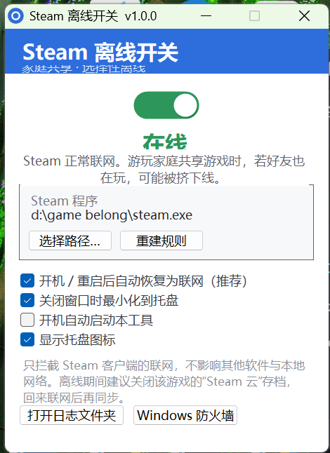

# Steam 离线开关 · Steam Offline Switch

[English](README.en.md) · [实现原理](docs/HOW-IT-WORKS.md) · [常见问题 / 排障](docs/TROUBLESHOOTING.md)

在 Windows 上一键让 **Steam 客户端「离线」**，从而可以**和好友同时玩同一款 Steam 家庭共享游戏**——而且**不用断网**，你电脑上其他程序照常联网。



> 独立社区工具，非 Valve / Steam 官方产品。仅操作 Windows 防火墙，不注入、不改游戏文件、不装驱动。Windows 10/11 + .NET Framework 4.x（系统自带）。

---

## 它解决的痛点

如果你加入了 Steam 家庭组（Family Sharing），一定遇到过这件事：

> **好友在玩某款共享游戏时，你就玩不了**——同一款游戏在同一时间只能有一个人在线玩。

Steam 的判定逻辑是：谁的账号「在线」并启动了那款游戏，谁就占用了这份共享授权。所以只要你能让**自己的 Steam 处于离线状态**，Steam 就不会再去校验「这款游戏是不是已经有别人在玩」，于是**你俩就能同时玩同一款游戏**了。

问题是，为了离线，很多人第一反应是**拔网线 / 关 Wi-Fi**——但这会把你电脑上所有东西都断掉：正在跑的下载、远程桌面、本地服务、语音、网页……全遭殃。

**这个工具就是干一件事：只让 Steam 离线，别的都照常联网。**

- 🎮 **一键切换**：界面一个大开关，绿色「在线」⇄ 橙色「已离线」。
- 🚫 **只拦 Steam**：只阻断 `steam.exe`，不碰 `SteamService.exe`，不影响 Steam 登录能力、不影响其他任何软件。
- ⚡ **即时生效**：切换走的是 Windows 防火墙规则的「启用/停用」，**无需重启 Steam**。
- 🧹 **干净可逆**：不写系统服务、不装驱动、不注入进程；随时一键删除规则、彻底还原。
- 🔔 **存档安全提醒**：软件会提醒你离线期间关闭「Steam 云」，避免存档冲突（详见下方[重要提醒](#重要提醒-)）。

## 工作原理（一句话）

给 `steam.exe` 在 **Windows 防火墙**里建 6 条**出站「阻止」规则**；开关「在线/离线」= 批量启用或停用这些规则。规则一直存在，退出本工具后状态也保持。完整原理见 [docs/HOW-IT-WORKS.md](docs/HOW-IT-WORKS.md)。

## 下载与安装

1. 到 [**Releases**](https://github.com/kevin-12-ou/steam-offline-switch/releases/latest) 下载 `SteamOfflineSwitch.exe`。
   也可以直接用源码里已编译好的 [`dist/SteamOfflineSwitch.exe`](dist/SteamOfflineSwitch.exe)。
2. 双击运行。程序会请求**管理员权限**（管理防火墙所必需）。
   - 若你的 UAC 设为「不提示直接提升」，会**静默提权**，不弹框；
   - 否则请在弹窗中点「是」，或右键 →「以管理员身份运行」。
3. 看到主界面即表示就绪。

> 说明：exe 未做代码签名，首次运行 Windows SmartScreen 可能提示「未知发布者」，点「更多信息 → 仍要运行」即可。不放心可以按[从源码编译](#从源码编译)自行构建。

### 系统要求

| 项目 | 要求 |
| --- | --- |
| 系统 | Windows 10 / 11（64 位） |
| 运行时 | .NET Framework 4.x（Win10/11 自带，无需安装） |
| 权限 | 管理员（程序自动请求提权） |
| 依赖 | 无第三方运行库 |

## 使用方法

1. 双击 `SteamOfflineSwitch.exe`，打开主界面。
2. 顶部大开关：
   - 绿色「**在线**」= Steam 正常联网；
   - 橙色「**已离线**」= Steam 已被阻断联网。
3. **玩共享游戏前**：把开关切到「已离线」。若 Steam 仍显示在线，按界面提示**重启一次 Steam** 让它进入离线模式即可（此后可和好友同时玩）。
4. **玩完**：把开关切回「在线」，Steam 恢复正常联网、云存档重新同步。
5. 界面里「Steam 程序」显示当前拦截的路径；若识别有误，点「**选择路径…**」手动指定 `steam.exe`，再点「**重建规则**」。

### 托盘 & 自启动

- **显示托盘图标**：右键托盘图标可快速「切换在线/离线」「打开窗口」「重启 Steam」「删除全部规则」「退出」。
- **关闭窗口时最小化到托盘**：点 × 不退出，而是收进托盘。
- **开机自动启动本工具**：写入 `HKCU\...\Run`（可选，默认关闭）。
- **开机 / 重启后自动恢复为联网（推荐）**：电脑重启后自动切回在线，避免忘记恢复。**建议保持勾选。**

> 单实例：如果窗口被收进了托盘，**再双击一次 exe 就会把窗口唤回前台**；也可以双击托盘图标。

## 重要提醒 ⚠️

1. **离线期间没有云存档**。离线后游戏存档不会上传云端，若好友那边也在用同一存档位，容易冲突。**离线玩之前，建议在该游戏「属性 → 通用」里关闭「Steam 云」**，等切回在线后再重新开启并同步。
2. **玩完记得切回「在线」再退出 Steam**，让本地存档同步上去。
3. **能否同时玩取决于 Steam 家庭组规则**。本工具只负责让「你的 Steam 离线」，不改变 Steam 本身的共享策略；请遵守 Steam 用户协议。
4. **只影响 Steam**。其他程序的网络完全不受影响；想让别的程序断网需另加规则。

## 常见问题

**Q：双击图标没反应 / 打不开？**
- 本工具是单实例的。若之前最小化到托盘，窗口只是藏在右下角托盘区，并未退出。**再双击一次 exe 即可唤回**，或双击托盘图标。
- 若托盘图标也没有：任务管理器结束 `SteamOfflineSwitch.exe` 后重新双击。

**Q：切到「离线」但 Steam 还能联网？**
- 确认「Steam 程序」路径就是正在运行的 `steam.exe`（Steam 可能装在别的盘/目录）；必要时「选择路径…」→「重建规则」。
- 切换瞬间 Steam 可能仍维持已建立的连接，等几秒或重启一次 Steam 客户端即可。

**Q：会把我整个网络断掉吗？**
- 不会。只针对 `steam.exe` 的出站连接，DNS、浏览器、本机其他服务都正常。

**Q：怎么彻底卸载 / 还原？**
- 托盘右键 →「删除全部防火墙规则…」，删除本工具建立的 6 条规则，Steam 立即恢复联网。
- 再删除程序文件夹即可（不写系统服务、不装驱动、不残留后台）。

**Q：日志在哪？**
- 主界面左下「打开日志文件夹」→ `%LOCALAPPDATA%\SteamOfflineSwitch\app.log`。

更多排查见 [docs/TROUBLESHOOTING.md](docs/TROUBLESHOOTING.md)。

## 命令行（可选，适合脚本 / 自动化）

`SteamOfflineSwitch.exe --cli <命令>`，结果写入 `%LOCALAPPDATA%\SteamOfflineSwitch\cli-result.txt`：

| 命令 | 作用 | 返回 |
| --- | --- | --- |
| `status` | 查询当前是否被拦截 | `OPEN` / `BLOCKED` |
| `offline` | 切到离线（启用阻止规则） | `BLOCKED` |
| `online` | 切到在线（关闭阻止规则） | `OPEN` |
| `ensure` | 确保 6 条规则存在（不改开关状态） | `OK` |

例如配合游戏启动脚本：开玩前 `--cli offline`，退出后 `--cli online`。

## 从源码编译

只依赖系统自带的 .NET Framework 4.x 编译器，无需 Visual Studio / .NET SDK：

```powershell
powershell -ExecutionPolicy Bypass -File .\build.ps1
```

输出 `dist\SteamOfflineSwitch.exe`。图标由 `make-icon.ps1` 生成，清单 `build\app.manifest` 声明 `requireAdministrator` 与 DPI 感知。

## 项目结构

```
steam-offline-switch\
├─ src\                     C# / WinForms 源码
├─ build\                   app.ico / app.manifest
├─ dist\SteamOfflineSwitch.exe  已编译程序
├─ build.ps1                编译脚本（系统自带 csc）
├─ make-icon.ps1            生成应用图标
├─ docs\                    原理 / 排障 / 截图
└─ README.md / README.en.md
```

## 免责声明

本项目仅供个人学习与自用，与 Valve / Steam 无关。使用本工具造成的存档丢失、账号风险或其他损失由使用者自行承担。请遵守 [Steam 用户协议](https://store.steampowered.com/subscriber_agreement/) 及家庭共享相关规定。

## 许可

[MIT](LICENSE)
